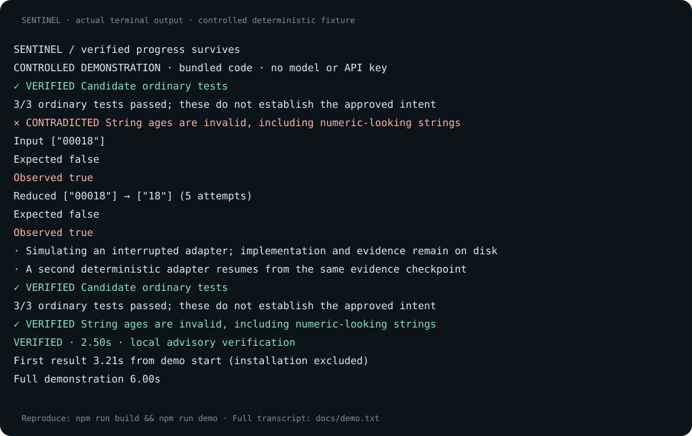

<div align="center">

# ◈ SENTINEL

### Your agent can stop. Your verified progress survives.

**Independent checks. Reproducible failures. Evidence-backed continuation.**

[Quick start](#see-it-work) · [Use your repository](#use-your-repository) · [Trust model](docs/THREAT-MODEL.md) · [Architecture](docs/ARCHITECTURE.md)

</div>

An AI coding agent can report success while the tests miss the bug. It can also stop halfway through a task, leaving the next agent to reconstruct what is real.

SENTINEL connects those problems: it checks code against developer-approved behaviour, records what happened, and carries that evidence into the next development session. It keeps the implementation, counterexamples, uncertainties and next actions together.

```text
TASK → AGENT → CHANGES → VERIFICATION → EVIDENCE → CONTINUATION
```

SENTINEL is a local-first TypeScript CLI. Version 0.1 focuses on repairs and refactors of existing deterministic exported JavaScript/TypeScript functions, JSON inputs and outputs, and Vitest tests. It works offline except when you choose an external coding agent.

## See it work

Requires **Node.js 22.12+, 24.x or 26+**, npm and Git. macOS and Linux are the initial targets.

```sh
git clone https://github.com/rossbuckley1990-hash/sentinel-verified.git
cd sentinel-verified
npm ci
npm run build
node dist/cli.js demo
```

No API key, subscription or model download is needed. The controlled demonstration runs real code and real Vitest tests:

1. A deliberately faulty patch passes the ordinary tests.
2. A preserved acceptance contract finds a concrete input with the wrong result.
3. SENTINEL reduces the counterexample and shows expected versus observed behaviour.
4. An interrupted fixture adapter hands off its checkpoint to a second adapter.
5. The corrected implementation passes the same acceptance checks.
6. A JSON evidence receipt and a self-contained HTML report preserve the result.

**The demo is a bundled experiment, not an allegation about a named coding agent.** Fixture adapters are deterministic scripts. They let you exercise interruption and continuation without commercial services.



See the [captured terminal run](docs/demo.txt) for reproducible visual evidence. The command prints the evidence and HTML report locations; open the report in any browser. It makes no network requests.

For the short command throughout this README, link the local build:

```sh
npm link
sentinel demo
```

No npm registry publication is assumed. You can always replace `sentinel` with the absolute path to `node /path/to/sentinel-verified/dist/cli.js`.

## Use your repository

Install your project's dependencies first. Review the source before allowing it to execute locally. SENTINEL's workspaces are **not a security sandbox**.

Create a contract **outside the repository the agent can edit**. For a module at `src/access.ts` exporting `isAdult` and `greeting`, a small contract looks like this:

```json
{
  "schemaVersion": 1,
  "objective": "Reject malformed ages while preserving valid age checks and greetings",
  "approvedBy": "developer",
  "allowedPaths": ["src/access.ts"],
  "requirements": [
    {
      "id": "reject-string-ages",
      "kind": "must-change",
      "description": "A string must never be accepted as an age",
      "module": "src/access.ts",
      "export": "isAdult",
      "cases": [{ "args": ["18"], "expected": false }],
      "invariant": {
        "argument": 0,
        "domain": "string",
        "seeds": ["00018"],
        "args": [null],
        "expected": false
      }
    },
    {
      "id": "preserve-valid-ages",
      "kind": "must-preserve",
      "description": "Adults qualify; minors do not",
      "module": "src/access.ts",
      "export": "isAdult",
      "cases": [
        { "args": [18], "expected": true },
        { "args": [17], "expected": false },
        { "args": [42], "expected": true }
      ]
    },
    {
      "id": "preserve-greetings",
      "kind": "must-preserve",
      "description": "Keep the greeting format",
      "module": "src/access.ts",
      "export": "greeting",
      "cases": [{ "args": ["Ada"], "expected": "Hello, Ada!" }]
    }
  ]
}
```

`approvedBy` records your approval label; it is not an authenticated signature. A contract is authoritative because you reviewed and supplied it. SENTINEL does not silently promote inferred requirements to approved requirements. The optional invariant explicitly says that the same expected value applies throughout its declared input domain; this permits input reduction. Individual examples alone do not justify that assumption.

Start an agent-assisted task:

```sh
sentinel run "Reject malformed ages while preserving valid age checks and greetings" \
  --repo /path/to/project \
  --contract /path/outside/project/acceptance.json \
  --agent codex \
  --allow-local
```

Use the exact objective from the approved contract. SENTINEL creates a managed workspace, preserves the baseline and approved contract, runs the agent and records independent checks. The original repository stays available; the command identifies the managed workspace containing the changes.

Continue from its recorded state with another adapter:

```sh
sentinel continue --agent claude
```

The receiving agent gets the objective, approved requirements, source identity, observed failures, unresolved questions and next actions. It receives evidence-backed context, not another model's hidden reasoning. Source identity and checkpoint integrity are checked before continuation.

If you deliberately edited the managed workspace between runs, use `sentinel continue --agent claude --adopt-changes` to record those edits as unverified and check them again. A plain continuation rejects unexpected source drift. Local-execution consent persists in the session.

To verify a change you've already made, compare the current repository with a committed baseline:

```sh
sentinel verify --repo /path/to/project --baseline HEAD \
  --contract /path/outside/project/acceptance.json --allow-local
```

Use `--baseline <commit>` when the candidate is already committed. Without an approved contract, available tests can still run, but behaviour claims remain explicitly limited. `allowedPaths` contains exact relative paths, not globs; changes to tests, CI or dependency definitions still require review. Use `--store /path/to/store` to select an independent store; keep it outside the project.

Inspect or render the latest session, select an older one, or replay a receipt:

```sh
sentinel inspect
sentinel report --session SESSION_ID
sentinel replay RECEIPT_HASH --allow-local
sentinel doctor
```

The default store is `~/.sentinel` (override with `--store` or `SENTINEL_HOME`). Session reports live at `STORE/sessions/SESSION_ID/report.html`; standalone verification reports live at `STORE/reports/RECEIPT_HASH.html`. Immutable content objects, including receipts and contracts, live at `STORE/objects/HASH`. Replay reconstructs the recorded source; it still needs compatible installed dependencies and local-execution consent.

For all commands and options:

```sh
sentinel --help
```

## Carry a checkpoint to another machine

```sh
sentinel export --out task.sentinel.json
# On the receiving machine, after installing SENTINEL:
sentinel import task.sentinel.json
sentinel continue --agent codex --allow-local
```

The bundle includes the selected source, contracts, receipts and agent logs. Review it before sharing. Import validates content hashes and schemas, restores a new managed workspace and marks prior results historical. Dependencies are not bundled; install reviewed project dependencies in the reported workspace when needed. The receiving machine must explicitly consent to local execution and rerun checks.

## What a result means

| Status | Meaning |
| --- | --- |
| **VERIFIED** | The specified check passed on its recorded inputs. |
| **CONTRADICTED** | An observation conflicts with the approved requirement. |
| **UNVERIFIED** | Available evidence cannot establish the claim. |
| **REVIEW REQUIRED** | A change needs a developer's judgement. |
| **ENVIRONMENT FAILURE** | Verification could not complete reliably. |

SENTINEL distinguishes **must-change** requirements from **must-preserve** requirements, compares baseline and candidate behaviour, inspects changes to tests and CI, and records unexpected differences. A warning about a changed test is a request to review evidence, not an accusation of cheating.

Passing a test suite does not prove arbitrary software correct. Neither does passing SENTINEL's sampled checks. A bad contract can approve bad behaviour. Read the [threat model](docs/THREAT-MODEL.md) before using results for a release or merge decision.

## Can I trust the evidence?

Receipts bind results to source snapshots, contract content, command arguments and captured outputs. Content-addressed records and versioned checkpoints make accidental corruption and stale source detectable. Protected verification inputs live outside the agent's working directory.

This is **local advisory verification**. A process with unrestricted access to the same operating-system account can alter the store, dependencies or verifier. Hashes are not signatures. Git copies and worktrees are not isolation boundaries. Version 0.1 does not supply an isolated runner or remotely enforced merge gate. Arbitrary project execution requires `--allow-local`; use an independently isolated disposable environment for source you do not trust.

The HTML report presents the same receipt and continuation state. It contains no remote assets, JavaScript or analytics. It is not a second application or a source of new claims.

## Integrations and supported scope

| Capability | Scope |
| --- | --- |
| Ordinary tests | Pinned Vitest with SENTINEL's explicit Node configuration; custom project plugins/configuration/setup are not loaded. |
| Independent behaviour | Existing deterministic exported JS/TS functions with JSON-compatible arguments and results; baseline observation must be available. |
| Counterexamples | Recorded failing examples; bounded reduction for explicitly declared constant-result string, number or array invariants. |
| Negative controls | Up to ten requirement checks are challenged with deliberately wrong constant exports; this is not a general mutation score. |
| Baseline and candidate | Content-addressed source snapshots, Git identities and recorded file changes. |
| Recovery and handoff | Durable versioned checkpoint, source validation and bounded receiving-agent context. |
| Offline adapters | `fixture-broken`, `fixture-interrupt`, `fixture-fix`; controlled demo only. |
| Model adapters | Codex CLI and Claude Code, subject to installed capability checks and authentication. |
| Browser/UI, live services, nondeterminism | Outside the initial verification scope. |
| Hostile-code isolation, signed attestation, remote merge gate | Not supplied by this release. |

A live authenticated Codex 0.163.0 run repaired the controlled project and passed independent verification. Claude 2.1.301 was installed but unauthenticated on the release machine: its adapter has CLI capability/protocol tests, but live Claude execution was not validated.

See [integration details](docs/INTEGRATIONS.md) for inspected CLI interfaces and the distinction between deterministic tests and live model validation.

## Reproduce the checks

```sh
npm ci
npm run build
npm test
npm run benchmark
```

In the measured synthetic corpus, SENTINEL flagged **12/12 problem cases** whose ordinary tests passed, accepted **3/3 legitimate fixes/refactors**, reproduced **15/15** code-case outcomes, and passed **5/5** continuity/integrity scenarios. This is a small public corpus, not a production detection-rate estimate.

The benchmark includes explicit expected outcomes for legitimate changes, deceptive green tests, invalid behaviour and continuity failures. Results distinguish ordinary Vitest outcomes from SENTINEL's bounded checks. They measure the included corpus, not all software or all agent behaviour. See [benchmark methodology and recorded results](benchmarks/README.md).

## Design and contribution

- [Architecture and schemas](docs/ARCHITECTURE.md)
- [Trust boundaries and failure modes](docs/THREAT-MODEL.md)
- [Design decisions](docs/DECISIONS.md)
- [Contributing](CONTRIBUTING.md)
- [Security reporting](SECURITY.md)

SENTINEL is released under the [MIT licence](LICENSE). Releases are versioned source archives with CI validation; package publication is a separate, explicit step.

**Keep the code. Keep the counterexample. Let the next agent start from what the evidence supports.**
