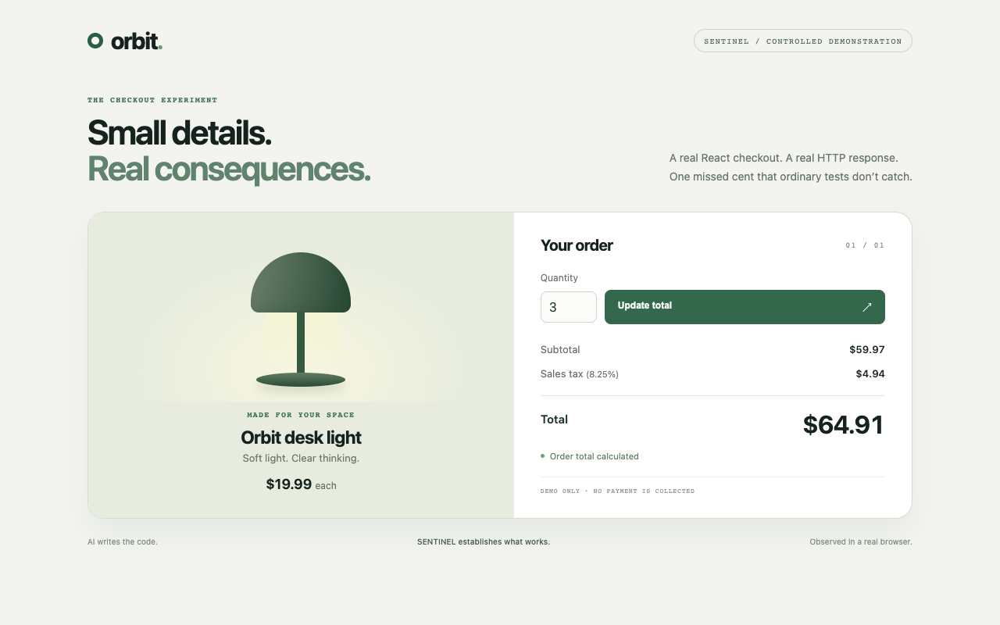
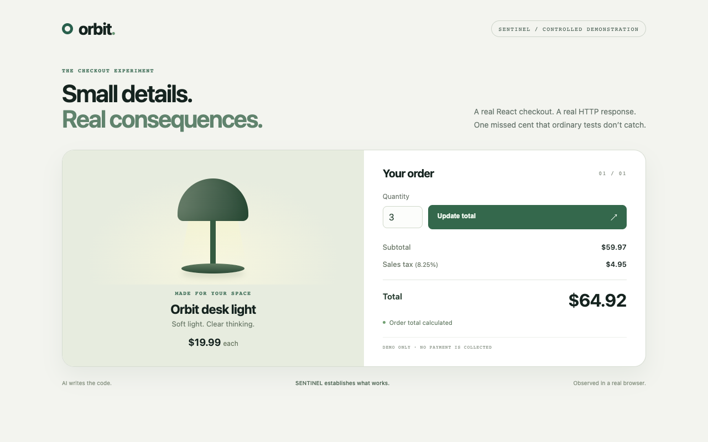

<div align="center">

# ◈ SENTINEL

### AI writes the code. SENTINEL establishes what works and keeps the progress.

**Build → Demonstrate → Continue**

[Try it](#see-it-work) · [Start a task](#use-your-project) · [Evidence and trust](#what-you-can-trust) · [Supported projects](#supported-projects)

</div>

An agent's success message is a claim. SENTINEL checks the actual software against criteria you approve, preserves the code and evidence, and gives the next agent an actionable checkpoint when work stops.

```sh
cd my-project
sentinel run "Fix the bug"
```

SENTINEL proposes a verification plan, asks for the missing expected outcomes, obtains approval, launches your existing agent, checks its changes and feeds reproducible failures into a bounded repair attempt. You finish with a clear result, a reviewable Git patch and resumable work.

**v1.0** extends the original deterministic function verifier to supported Node APIs and React applications. [Release artifacts](https://github.com/rossbuckley1990-hash/sentinel-verified/releases/tag/v1.0.0) · [Executed validation and limitations](docs/V1-VALIDATION.md).

## See it work

Requires **Node.js 22.12+, 24.x or 26+, npm and Git**. macOS and Linux are supported. The browser demonstration also needs an installed Chrome/Chromium/Edge or an explicitly installed Playwright Chromium. SENTINEL does not download a browser behind your back.

```sh
npm install --global --ignore-scripts https://github.com/rossbuckley1990-hash/sentinel-verified/releases/download/v1.0.0/sentinel-verified-1.0.0.tgz
sentinel demo
```

This installs the GitHub release archive. npm-registry authentication was unavailable; `npm install -g sentinel-verified` is **not** advertised as a published registry package.

Or build from source:

```sh
git clone https://github.com/rossbuckley1990-hash/sentinel-verified.git
cd sentinel-verified
git checkout v1.0.0
npm ci
npm run build
npm link
sentinel demo
```

No API key, paid model or external application service is needed. The demo runs a real React checkout and Node API:

1. Three ordinary tests pass, but a rounding error silently loses a cent.
2. Approved HTTP and browser examples show **$64.91 instead of $64.92**.
3. An interrupted deterministic adapter leaves the source and failed evidence intact.
4. A second deterministic adapter repairs the calculation.
5. The same checks run again; the report contains actual before/after screenshots, source identities and a continuation checkpoint.
6. A Git patch makes the change reviewable.

**This is a labelled controlled experiment, not a fabricated live Codex or Claude run.** The original browser-free experiment remains available with `sentinel demo --functions`.

| Before: observed defect | After: observed correction |
| --- | --- |
|  |  |

An integrated Apple Silicon run showed the first contradiction in **24.09 seconds** and completed the demonstration in **41.72 seconds**. Installation was excluded; this is one measured run, not a guarantee. [Validation record](docs/V1-VALIDATION.md).

If a browser is missing, install Chrome or explicitly install the pinned test browser from the source checkout:

```sh
npx --yes playwright-core@1.64.1 install chromium
```

You can also set `SENTINEL_BROWSER_EXECUTABLE` to a reviewed installed browser. Browser failure stays an environment failure; it is not replaced with a fake screenshot or successful check.

## Use your project

Install your project's dependencies first. Start from a Git repository containing the supported application and its Vitest tests:

```sh
sentinel run "Add a stable error code to invalid API-key responses"
```

Discovery reads repository text without executing it. For deterministic functions it extracts literal examples from tests, documentation and sufficiently precise objectives. For applications it identifies server/route/selector hints and opens a concise acceptance editor: approve the server command, specify real HTTP responses or browser interactions, retain important existing behaviour, and review the authorised file paths.

A hint is not a requirement. Expected results come from your reviewed objective and examples. Ambiguous intent remains visible. Optional model interpretation can suggest application scenarios using repository tests and documentation:

```sh
sentinel run "Fix the checkout rounding" --propose-with codex
```

This explicitly invokes Codex in read-only mode for suggestions. **The model cannot approve its expectations.** You still review the exact scenarios. Coverage counts only the explicitly reviewed objective aspects and mapped examples; an inadequate approved contract can still miss a defect.

After approval, SENTINEL records the contract outside the agent workspace, asks for execution consent, creates a managed source copy and runs the selected agent. The input project is not overwritten.

```sh
sentinel run "Fix the bug" --agent codex --repairs 2
sentinel continue                     # reuse the previous adapter
sentinel continue --agent claude      # switch when authenticated
sentinel report --open
```

Real agents get one repair attempt by default; `--repairs 0..3` changes the bound. Contradictions supply exact inputs/interactions and expected/observed values. Every failed receipt survives. Environment failures, unresolved requirements, review blockers, interruption and no source progress stop automatic repairs.

The next agent receives the actual source identities, approved criteria, changed files, counterexamples, execution limitations and next actions. This transfers inspectable state, not hidden model reasoning. Unexpected source drift requires explicit `--adopt-changes`; corrupt checkpoints fail safely.

### Review and take the changes

```sh
sentinel export --patch --out changes.patch
# Inspect the patch and its reported baseline compatibility first.
git apply --check changes.patch
git apply changes.patch
```

Patch export supports additions, deletions, executable modes and binary content. It does not modify the input checkout, merge a branch or deploy anything. The last command above is your explicit decision after review.

For a portable checkpoint containing source, contracts, receipts, screenshots and agent transcripts:

```sh
sentinel export --out task.sentinel.json
sentinel import task.sentinel.json
sentinel continue --session IMPORTED_ID --agent codex --allow-local
```

Review bundles before sharing or executing them. Dependencies are not included; install reviewed dependencies in the imported workspace. Imported results are historical until rechecked in the new environment.

### Automation and existing changes

An externally reviewed contract remains supported without interactive authoring:

```sh
sentinel run "EXACT APPROVED OBJECTIVE" \
  --contract /path/outside/project/acceptance.json --agent codex --allow-local

sentinel verify --baseline HEAD \
  --contract /path/outside/project/acceptance.json --allow-local

sentinel replay RECEIPT_HASH --allow-local
sentinel inspect
sentinel doctor
sentinel --help
```

See the labelled [function contract](fixtures/demo/contract.json) and [application contract](fixtures/checkout/acceptance.json). These demonstrate the formats; they are not automatically approved specifications for your project. Schema-1/2 contracts and existing checkpoints remain readable.

The default store is `~/.sentinel`, configurable with `--store` or `SENTINEL_HOME`. Reports live at `STORE/sessions/ID/report.html`; standalone verification reports at `STORE/reports/HASH.html`. Reports are self-contained, with no scripts, analytics or remote assets.

## Supported projects

| Capability | v1 scope |
| --- | --- |
| Functions | Deterministic exported JS/TS functions with JSON-compatible input/output; original verification remains supported. |
| APIs | Local Node HTTP servers using `PORT`/`HOST` or a reviewed `{port}` argv; exact status and JSON/text response examples. |
| React/browser apps | Existing local apps, including Vite, with reproducible CSS-targeted click/fill/select/check/key interactions and exact text/value/visibility assertions. |
| Existing tests | Pinned Vitest with SENTINEL's explicit Node configuration. Custom plugins, project configuration and setup files are not loaded. |
| Browser evidence | Actual before/after PNGs and bounded interaction/response records; repeated observations detect sampled nondeterminism. |
| Repair | Bounded retries against the unchanged approved contract. |
| Agents | Codex and Claude Code, with installed CLI capability checks. Authentication is separate. |
| Docker | Optional function verification only. Application verification currently requires approved local execution; no isolation fallback. |
| Out of scope | Hosted services, production credentials, arbitrary desktop use, universal app/framework support, remotely enforced merge gates and mathematical correctness proofs. |

The application must be able to start from the captured source with installed dependencies and no external service dependency. Missing browsers, failed startup, unavailable dependencies and unsupported verification configurations are reported explicitly. The browser blocks external page requests, service workers and WebSockets; this does **not** isolate the application server or coding agent.

## What you can trust

| Result | Meaning |
| --- | --- |
| **VERIFIED** | The specified observations passed on the recorded source and inputs. |
| **CONTRADICTED** | Observed behaviour conflicts with an approved requirement. |
| **UNVERIFIED** | Evidence or acceptance coverage is insufficient. |
| **REVIEW REQUIRED** | A change or inconsistent expectation needs human judgement. |
| **ENVIRONMENT FAILURE** | Reliable execution could not complete. |

Receipts bind source snapshots, contracts, argv, outputs and artifact hashes. Changed tests and CI definitions are reviewed; preserved baseline tests run against the candidate. Wrong constant exports challenge selected function checks. These are bounded mechanisms, not arbitrary semantic proof.

**Local advisory execution is not a security boundary.** An unrestricted process under your account can modify local state. Hashes detect ordinary corruption, not malicious replacement of an entire chain. Optional Docker confines supported verification, not the coding agent. Requested isolation never silently falls back. Read the [threat model](docs/THREAT-MODEL.md) and [isolation documentation](docs/ISOLATION.md).

## Reproduce the evaluation

```sh
npm ci
npm run build
npx --yes playwright-core@1.64.1 install chromium
SENTINEL_TEST_BROWSER=1 npm test
npm run benchmark
npm run benchmark:public
npm ci --prefix benchmarks/web/runtime --ignore-scripts
npm run benchmark:web
```

The original synthetic and historical public-project corpora remain. The new application evaluation uses pinned Express and React TodoMVC source, predeclared labels, development/held-out cases, exact provenance, correct repairs, regressions, an inadequate-contract miss and environment failures. Adapted tests are identified; they are not presented as an upstream project's complete test suite. [Methodology](benchmarks/web/README.md) · [v1 validation](docs/V1-VALIDATION.md).

No broad superiority or agent-productivity claim is made. Existing project tests and trustbut remain useful for covered regressions; Stryker measures mutation sensitivity. A real direct-Codex control and a complete ordinary-summary handoff also passed the same approved application outcomes. [Measured comparison](docs/V1-AGENT-COMPARISON.md). No handoff productivity advantage was established.

## Contribute

MIT licensed. Start with [contributing](CONTRIBUTING.md), [architecture](docs/ARCHITECTURE.md), [security reporting](SECURITY.md) and [release process](docs/RELEASE.md). Useful contributions expand demonstrated coverage, improve real outcomes or make failure recovery simpler—without weakening what VERIFIED means.
