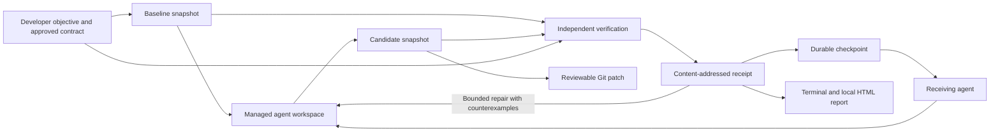

# Architecture

SENTINEL is one local CLI with a self-contained evidence-report renderer. It coordinates implementation, independent observation and continuation for two bounded categories: deterministic exported JavaScript/TypeScript functions with JSON values, and local Node APIs or React/Vite applications with approved HTTP/browser scenarios. Existing function verification remains intact. The application extension is an observation runner, not a general semantic understanding engine.

## The data flow

The agent changes implementation files. The verifier owns the execution and classification of checks. Agent output is recorded as unverified narrative; it is never interpreted as a passing test.

## Modules

| Component | Responsibility |
| --- | --- |
| CLI | Parse commands, expose one session flow and report errors with useful exit status. |
| Discovery and onboarding | Propose literal function examples or application startup/target hints; collect expected scenarios, finite scope, explicit approval and separate execution consent. |
| Optional model proposal | Ask the configured Codex CLI for unapproved application suggestions and questions under its read-only sandbox. |
| Configured isolation | Run supported function verification in a bounded Docker container without host credentials or network; requested application isolation is explicitly unsupported and never falls back. |
| Session orchestration | Preserve task state, invoke adapters, perform bounded repairs justified by current counterevidence, checkpoint interruption and continue from validated source. |
| Agent adapters | Detect installed capabilities, invoke actual CLI interfaces and record outcomes. |
| Snapshot store | Record file content, content hashes, file modes and Git identity; materialize execution copies. |
| Contract schema | Validate developer-supplied, versioned behavioural requirements. |
| Verifier | Run ordinary and preserved checks, compare behaviour, reconcile declared coverage and classify changes. |
| Application runner | Start temporary baseline/candidate servers; execute bounded HTTP and browser checks; preserve observed values, PNGs and JSON execution records. |
| Patch export | Construct a binary Git patch from captured source, check it against the exact baseline in a temporary directory, and leave the developer’s checkout unchanged. |
| Process runner | Execute explicit argv, collect bounded output, enforce timeouts and distinguish execution failure. |
| Counterexample reducer | Search a bounded set of smaller inputs under an explicitly approved invariant. |
| Report renderer | Present the same receipt, source identities and continuation state as a self-contained HTML document. |

## Contracts and intent reconciliation

A version-1 contract contains an objective, an approval label and requirements. Each requirement has an ID, a `must-change` or `must-preserve` kind, a source module, an export name and explicit input/expected-output pairs. Optional probes ask for baseline/candidate observations without pretending to specify the correct answer. Optional allowed paths document the intended change scope.

Version-2 contracts additionally bind interactive function approval to the reviewed proposal and baseline. Version 3 adds application startup configuration, HTTP/browser scenarios and finite objective coverage. Interactive application approval binds the entire reviewed body—including scenarios, expected results, path scope and coverage—to a separate protected proposal. An externally reviewed manual contract can omit interactive metadata; its approval label is a caller assertion, not an authenticated signature.

A `must-change` example asks whether the candidate now meets the requested behaviour. A `must-preserve` example also makes the baseline relevant: if the baseline never exhibited the claimed preserved behaviour, the record must surface that problem instead of manufacturing a success story.

An invariant is an explicit constant-result assertion over a declared argument domain (`string`, `number` or `array`). Its seeds supply concrete experiments. Reduction may change the selected argument while keeping the invariant's expected answer. This is stronger than a single example and must be approved as such. The engine does not infer it from a failing test.

`allowedPaths` is a list of exact relative file paths. It authorises source-change scope, not arbitrary behaviour. Test, CI and dependency-definition changes remain review items even when their paths appear in that list.

Version-3 coverage maps explicitly approved aspects to requirement/scenario IDs and records whether the developer confirmed the intended scope. `intent: "preserve"` supports an explicitly preservation-only refactor; a change task needs a must-change example. Missing mappings, unconfirmed scope or unresolved questions cannot produce full-task VERIFIED. The resulting counts describe finite declared aspects, not the fraction of all possible behaviour covered.

Every observation is bounded by what was actually executed. Sampled inputs cannot establish behaviour for the full input space. Unexplained changes are review items or unknowns, not automatic proof of wrongdoing.

## Execution and negative controls

The verifier materializes separate baseline, candidate and preserved-test copies. The preserved copy uses candidate implementation with baseline tests and control files restored. Vitest runs with SENTINEL's explicit Node configuration. Custom project Vitest/Vite test configuration, plugins and setup files are not loaded. Suites that need them remain outside the supported ordinary-test execution scope, even when the application's HTTP/browser checks can run. Starting an approved Vite development server is a separate application execution step and may load that server's configuration under the explicit execution consent.

Behavioural probes import approved module/export pairs in a separate Node process and compare JSON results. Candidate examples are repeated to catch some stateful or nondeterministic outputs, but this is not a complete nondeterminism detector. Dependencies are reused from an installed `node_modules` directory; they are not hermetically captured.

For up to ten requirements, a negative control temporarily replaces the selected module with a deliberately wrong constant export in an execution copy. The approved example must reject that result. This checks a narrow failure path in the verification harness. It is not systematic source mutation, a general mutation score or a replacement for Stryker.

## Application observations

An approved application command is an argv array, never a shell string. Each source version runs in its own materialized execution directory and receives a fresh loopback port, `HOST=127.0.0.1`, a temporary empty home and a filtered environment. A readiness HTTP response is required while the approved foreground process remains alive. A wrapper that exits while its descendant retains inherited pipes is an environment failure; the descendant's response cannot make the failed command successful. Every managed process group is stopped after its observation phase.

HTTP scenarios use real requests with exact status and JSON/text expectations. Redirects are not followed. Browser scenarios use Playwright with an already installed browser, fresh nonpersistent contexts and a bounded interaction/assertion vocabulary. Each scenario is repeated twice; differing observations are UNVERIFIED. Browser contexts reset between repetitions, while the application server is reused within each baseline/candidate phase. Stateful scenarios that cannot repeat deterministically need a suitable reviewed reset/startup design or remain unsupported.

Browser network routing permits the temporary application's origin and blocks external requests, WebSockets and service workers. This is a browser request policy, **not** isolation of the local application server or a hostile-code security boundary. The application process retains local OS permissions and can itself access the network. Docker application/browser verification is currently unsupported; an explicit Docker request fails without a local fallback.

The runner records bounded viewport PNGs and JSON interaction/response records, each stored by content hash. These are actual execution artifacts, not generated mockups or Playwright trace ZIPs. Before means baseline; after means candidate, including candidates that still fail. A screenshot alone does not establish correctness. Expected answers come from the approved contract and exact assertions. Browser/API failures are retained as reproducible scenarios; function invariant reduction remains the supported counterexample minimizer.

Application execution has bounded startup/check timeouts and a five-minute total budget. Server output and HTTP bodies are capped at 1 MB; each artifact is capped at 4 MB and artifacts at 40 MB per receipt. A requested browser is never silently downloaded or substituted if an explicit executable is invalid. Missing prerequisites, exhausted limits and unreliable execution produce environment failures.

## Bounded repair and useful incomplete outcomes

A real-agent session permits one additional automatic repair by default; `--repairs 0..3` selects the bound. A repair requires a current-source CONTRADICTED receipt with a failing approved requirement and no environment, unknown or review blockers. Interrupted/failed agents, stale source, inadequate intent and unexplained changes stop the automatic path rather than asking an agent to reinterpret its own success criteria.

The repair prompt contains the requirement ID, exact input/interaction, expected and observed values, and any supported reduced counterexample. It references the original failure receipt. The same baseline and approved contract are retained; all earlier receipts remain available. A repair that changes no source stops early. New source receives fresh independent verification, and a failed attempt cannot inherit an older successful receipt.

Incomplete sessions still retain implementation files, failures and next actions. `sentinel export --patch --out changes.patch` produces the captured change for review. Patch construction bypasses Git filters and external configuration and checks application in a disposable baseline copy. It does not apply, merge or overwrite changes in the original repository. A portable checkpoint export serves a different purpose: moving source and evidence together for continuation.

## Evidence and snapshots

Content objects use SHA-256 identities. A source snapshot records a map of relative file paths to content hashes, sizes and modes, plus repository, commit and branch identity. A snapshot can include working-tree changes; its hash is more precise than a commit ID alone for identifying that candidate.

A receipt records:

- Schema version, receipt identity, time and task objective.
- Baseline, candidate and contract hashes.
- Repository revision, selected runner and recorded execution boundary.
- Check statuses, input values, expected/observed results and counterexamples.
- Commands, working directories, exit codes, signals, timeouts and captured output.
- File-change classifications, limitations and next actions.
- For schema-2 receipts, finite coverage counts and content-addressed application artifacts with phase, scenario, media type and byte count.

Captured output can be bounded; truncation is recorded. A hash identifies the stored bytes, not their provenance or truth. Dependencies and runtime versions are part of reproducibility and require attention when replaying elsewhere.

## Checkpoint and continuation

A checkpoint records the objective, source and contract identities, workspace, task state, receipt references, adapter history, unverified statements, open questions and next actions. Writes are designed for interruption recovery. Session-level exclusion prevents two cooperating SENTINEL processes from editing one session simultaneously.

Continuation validates the checkpoint and its referenced evidence, checks that the workspace corresponds to the recorded candidate, and supplies a bounded context package to the receiving adapter. The package distinguishes verified checks, counterexamples and unverified narrative; it also includes changed-file identities, dependency definitions, prior runtime limitations and a path to the complete protected contract. The visible context has a size budget, and omitted content is not treated as absent requirements. New work is checked again before a new result is accepted.

This is context reconstruction from accessible project state. It is not a transfer of a model's private reasoning, inaccessible conversation history or hidden memory.

## Schema evolution

Existing version-1 manual contracts and version-2 interactive function contracts remain readable without rewriting their content. Format versions are independent of the package version:

| Record | Current supported versions | Meaning |
| --- | --- | --- |
| Function/application contract | 1, 2, 3 | 1: manual function criteria; 2: protected interactive function approval; 3: finite coverage and optional application scenarios. |
| Protected proposal | 1, 2 | 1: reviewed function discovery selections; 2: exact application contract body and question resolutions. |
| Verification receipt | 1, 2 | 1: existing verification records; 2: application artifacts and/or schema-3 coverage. |
| Source snapshot | 1 | File objects, modes and Git identity. |
| Checkpoint and atomic envelope | 1 | Existing durable state plus compatible additive continuation fields. |
| Portable bundle | 1 | Complete referenced objects, now including receipt-2 PNG/JSON artifacts. |

The v1 reader validates older evidence in place; older releases are not expected to understand contract 3 or receipt 2. Import validates artifact hashes, lengths and PNG signatures before publishing a session. Unknown incompatible versions must be rejected rather than interpreted as version 1. Type definitions live in `src/types.ts` and `src/application-schema.ts`; parsers are authoritative.

Future migrations should read the old schema, produce a new object with a new hash, retain the original object and record the migration provenance. Never overwrite an old receipt to change its meaning. Migration of summaries cannot turn historical claims into newly verified facts.

## Deliberate limits

No database, hosted service, queue or model is needed for the core. No general semantic-correctness theorem is claimed. No evidence in this project establishes uniqueness of proof-carrying continuity as an idea.

Local snapshots separate responsibilities and catch stale or altered inputs. They do not isolate hostile code. Consult the [threat model](THREAT-MODEL.md) for the boundary between useful local checks and adversarial security enforcement.

## Preserved approval and continuity protections

Read-only Git inspection disables fsmonitor, hooks and lazy fetching, and determines dirty state by comparing raw Git objects and filesystem bytes without status/filter conversion. Filter or EOL-normalised checkouts may conservatively appear dirty. These controls matter because even a status/listing command must not execute repository-configured code before consent. Proposal inputs are checked against the reviewed baseline; source changes while the approval screen is open invalidate approval. Adding one explicit example resolves only the generic missing-example question, never an unrelated ambiguous objective.

The per-repository session pointer prevents `continue` from choosing a different repository's global latest task. Outside an imported workspace, select its session ID explicitly. The preferred agent is the only stored onboarding preference; execution consent belongs to a session and runner and is reset on import.

The exact bounded agent input is a content object. A visible `SENTINEL_ACK` line can acknowledge its source and contract identities. This is an agent statement, not independent evidence of comprehension. The next source is independently verified even when acknowledgement is absent. A new verification infrastructure failure receives its own failure receipt; an older green result cannot represent that failed attempt. Reports label incomplete or source-stale sessions accordingly.

Interactive version-2 and version-3 contract loading also compares requirements and scope against the selected reviewed proposal. Editing a contract file while retaining an old approval/proposal identity invalidates it; use fresh interactive approval or an explicitly reviewed manual contract. This detects local drift, not an attacker rewriting the entire evidence chain.
