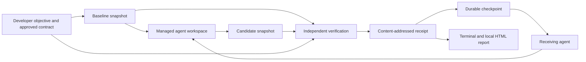

# Architecture

SENTINEL is one local CLI with a static evidence-report renderer. Its first release deliberately bounds the problem to repairs and refactors of existing deterministic exported JavaScript/TypeScript functions with JSON values and Vitest tests. Adding entirely new exports without a baseline observation is outside the initial verified-success scope.

## The data flow

The agent changes implementation files. The verifier owns the execution and classification of checks. Agent output is recorded as unverified narrative; it is never interpreted as a passing test.

## Modules

| Component | Responsibility |
| --- | --- |
| CLI | Parse commands, expose one session flow and report errors with useful exit status. |
| Discovery and onboarding | Statically propose literal checks, expose uncertainty, record explicit developer approval and separate execution consent. |
| Configured isolation | Run verification in a bounded Docker container without host credentials, network or a local fallback. |
| Session orchestration | Preserve task state, invoke adapters, checkpoint interruption and continue from validated source. |
| Agent adapters | Detect installed capabilities, invoke actual CLI interfaces and record outcomes. |
| Snapshot store | Record file content, content hashes, file modes and Git identity; materialize execution copies. |
| Contract schema | Validate developer-supplied, versioned behavioural requirements. |
| Verifier | Run ordinary and preserved checks, compare behaviour and classify changes. |
| Process runner | Execute explicit argv, collect bounded output, enforce timeouts and distinguish execution failure. |
| Counterexample reducer | Search a bounded set of smaller inputs under an explicitly approved invariant. |
| Report renderer | Present the same receipt, source identities and continuation state as a self-contained HTML document. |

## Contracts and intent reconciliation

A version-1 contract contains an objective, an approval label and requirements. Each requirement has an ID, a `must-change` or `must-preserve` kind, a source module, an export name and explicit input/expected-output pairs. Optional probes ask for baseline/candidate observations without pretending to specify the correct answer. Optional allowed paths document the intended change scope.

A `must-change` example asks whether the candidate now meets the requested behaviour. A `must-preserve` example also makes the baseline relevant: if the baseline never exhibited the claimed preserved behaviour, the record must surface that problem instead of manufacturing a success story.

An invariant is an explicit constant-result assertion over a declared argument domain (`string`, `number` or `array`). Its seeds supply concrete experiments. Reduction may change the selected argument while keeping the invariant's expected answer. This is stronger than a single example and must be approved as such. The engine does not infer it from a failing test.

`allowedPaths` is a list of exact relative file paths. It authorises source-change scope, not arbitrary behaviour. Test, CI and dependency-definition changes remain review items even when their paths appear in that list.

Every observation is bounded by what was actually executed. Sampled inputs cannot establish behaviour for the full input space. Unexplained changes are review items or unknowns, not automatic proof of wrongdoing.

## Execution and negative controls

The verifier materializes separate baseline, candidate and preserved-test copies. The preserved copy uses candidate implementation with baseline tests and control files restored. Vitest runs with SENTINEL's explicit Node configuration. Custom project Vitest/Vite configuration, plugins and setup files are not loaded; projects that require those features are outside the first release's execution scope.

Behavioural probes import approved module/export pairs in a separate Node process and compare JSON results. Candidate examples are repeated to catch some stateful or nondeterministic outputs, but this is not a complete nondeterminism detector. Dependencies are reused from an installed `node_modules` directory; they are not hermetically captured.

For up to ten requirements, a negative control temporarily replaces the selected module with a deliberately wrong constant export in an execution copy. The approved example must reject that result. This checks a narrow failure path in the verification harness. It is not systematic source mutation, a general mutation score or a replacement for Stryker.

## Evidence and snapshots

Content objects use SHA-256 identities. A source snapshot records a map of relative file paths to content hashes, sizes and modes, plus repository, commit and branch identity. A snapshot can include working-tree changes; its hash is more precise than a commit ID alone for identifying that candidate.

A receipt records:

- Schema version, receipt identity, time and task objective.
- Baseline, candidate and contract hashes.
- Repository revision and local advisory execution model.
- Check statuses, input values, expected/observed results and counterexamples.
- Commands, working directories, exit codes, signals, timeouts and captured output.
- File-change classifications, limitations and next actions.

Captured output can be bounded; truncation is recorded. A hash identifies the stored bytes, not their provenance or truth. Dependencies and runtime versions are part of reproducibility and require attention when replaying elsewhere.

## Checkpoint and continuation

A checkpoint records the objective, source and contract identities, workspace, task state, receipt references, adapter history, unverified statements, open questions and next actions. Writes are designed for interruption recovery. Session-level exclusion prevents two cooperating SENTINEL processes from editing one session simultaneously.

Continuation validates the checkpoint and its referenced evidence, checks that the workspace corresponds to the recorded candidate, and supplies a bounded context package to the receiving adapter. The package distinguishes verified checks, counterexamples and unverified narrative. New work is checked again before a new result is accepted.

This is context reconstruction from accessible project state. It is not a transfer of a model's private reasoning, inaccessible conversation history or hidden memory.

## Schema evolution

Version-1 manual contracts remain readable without rewriting their content. Interactive approval creates a version-2 contract with the proposal hash, approved baseline hash, exact approved requirement IDs, recorded question resolutions, unresolved intent and discovery limits. Snapshots, receipts, checkpoints and portable envelopes retain `schemaVersion: 1` with optional additive fields for the runner, full contract and handoff acknowledgement. A v0.1 reader is not expected to understand v0.2 contracts or the Docker runner; v0.2 reads existing v0.1 evidence unchanged. The authoritative TypeScript definitions live in `src/types.ts`; parsing rules are in the schema module. Consumers must reject unknown versions rather than silently treating them as version 1.

Future migrations should read the old schema, produce a new object with a new hash, retain the original object and record the migration provenance. Never overwrite an old receipt to change its meaning. Migration of summaries cannot turn historical claims into newly verified facts.

## Deliberate limits

No database, hosted service, queue or model is needed for the core. No general semantic-correctness theorem is claimed. No evidence in this project establishes uniqueness of proof-carrying continuity as an idea.

Local snapshots separate responsibilities and catch stale or altered inputs. They do not isolate hostile code. Consult the [threat model](THREAT-MODEL.md) for the boundary between useful local checks and adversarial security enforcement.

## v0.2 approval and continuity details

Read-only Git inspection explicitly disables fsmonitor and hooks: even a status/listing command must not execute repository-configured code before consent. Proposal inputs are checked against the reviewed baseline; source changes while the approval screen is open invalidate approval. Adding one explicit example resolves only the generic missing-example question, never an unrelated ambiguous objective.

The per-repository session pointer prevents `continue` from choosing a different repository's global latest task. Imported sessions require their explicit session ID. The preferred agent is the only stored onboarding preference; execution consent belongs to a session and runner and is reset on import.

The exact bounded agent input is a content object. A visible `SENTINEL_ACK` line can acknowledge its source and contract identities. This is an agent statement, not independent evidence of comprehension. The next source is independently verified even when acknowledgement is absent. A new verification infrastructure failure receives its own failure receipt; an older green result cannot represent that failed attempt. Reports label incomplete or source-stale sessions accordingly.
